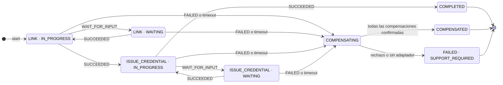
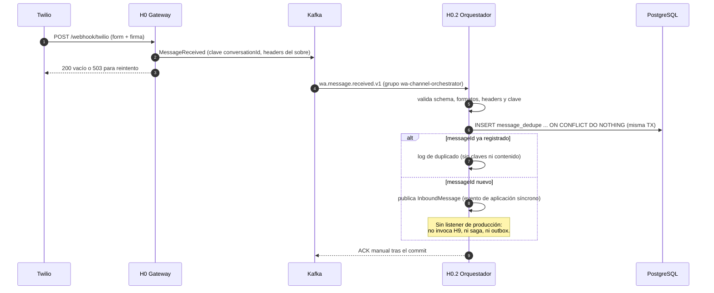

# Documentación de integración — canal WhatsApp bancario

Cierre de documentación del run `20261031-f8ae` (TASK-190). Consolida, en un solo lugar y
desde el código y los contratos vigentes: el README del stack para levantarlo y probarlo, el
catálogo de eventos del canal, la configuración de Twilio y las sagas del orquestador.

Documenta **lo que existe hoy en el repositorio**. Lo que todavía no está implementado se
marca explícitamente y no se presenta como funcionando.

| Documento | Contenido |
|---|---|
| [docs/local-devops.md](docs/local-devops.md) | Guía operativa del entorno local y del smoke E2E |
| [docs/local-smoke-data.md](docs/local-smoke-data.md) | Datos sintéticos del smoke (seed, excepción local de activación, limpieza) |
| [delivery/devops.md](delivery/devops.md) | Dockerfiles de integración, Kafka KRaft, PostgreSQL del orquestador, CI |
| [delivery/devops-local.md](delivery/devops-local.md) | Operación de H1–H6 por separado |
| [shared/contracts/events/README.md](shared/contracts/events/README.md) | Contratos de eventos v1 (fuente de verdad del catálogo) |

> **Estado de la verificación en este run.** No se acreditó un recorrido E2E. El Engine de Docker
> respondió acceso denegado al pipe `dockerDesktopLinuxEngine` y `GOOGLE_API_KEY` estaba ausente,
> por lo que no hubo salud de contenedores ni smoke real; el arnés informa `transport=ok` como
> resultado **parcial**. Además, por diseño del código actual faltan piezas para cerrar el
> recorrido: el orquestador no tiene listener de producción que invoque a H9 y H7 todavía no
> publica el transporte `/mcp`. Detalle en
> [evidencia TASK-187](docs/evidence/task-187-smoke.md) y en la sección 5.

---

## 1. README del stack local

### Qué es y qué no es

Entorno local multi-contenedor (un `docker-compose.yml` en la raíz) que materializa el canal:
Twilio → H0 gateway → Kafka → H0.2 orquestador → H9 agente → H7/H8 → servicios H1–H6 →
Kafka → H0 → Twilio.

- **Es** un compose raíz con una imagen por componente, Kafka en modo KRaft, Postgres por
  servicio, healthchecks y `depends_on` por salud, y scripts de arranque/parada/reset.
- **No es** un monolito, no usa Twilio real ni credenciales productivas, no reemplaza CI/CD y
  no define lógica de negocio (esa vive en cada componente).

### Componentes, puertos y salud

| Hito | Componente | Ruta | Puerto host | Salud | Contrato |
|---|---|---|---|---|---|
| H0.1 | Plataforma de eventos | `platform/wa-event-platform` | 8092 | `/actuator/health` | [events/](shared/contracts/events/README.md) |
| H0 | Gateway Twilio | `gateway/wa-twilio-gateway` | 8090 | `/actuator/health` | [handoff H0](shared/contracts/wa-twilio-gateway/handoff.md) |
| H0.2 | Orquestador del canal | `platform/wa-channel-orchestrator` | 8091 | `/actuator/health` | [handoff H0.2](shared/contracts/wa-channel-orchestrator/handoff.md) · [turno H9](shared/contracts/wa-conversation-agent/turn.md) |
| H1 | Usuarios | `services/wa-users-service` | 8080 | `/actuator/health` | [api.md](services/wa-users-service/delivery/api.md) |
| H2 | Credenciales y sesión | `services/wa-credentials-service` | 8082 | `/actuator/health` | [api.md](services/wa-credentials-service/delivery/api.md) · [renovación](shared/contracts/wa-credentials-service/renovacion.md) |
| H3 | Vínculo del canal | `services/wa-channel-service` | 8081 | `/actuator/health` | [api.md](services/wa-channel-service/delivery/api.md) |
| H4 | Cuentas | `services/wa-accounts-service` | 8084 | `/actuator/health` | [api.md](services/wa-accounts-service/delivery/api.md) |
| H5 | Tarjetas | `services/wa-cards-service` | 8086 | `/actuator/health` | [api.md](services/wa-cards-service/delivery/api.md) |
| H6 | Seguros | `services/wa-insurance-service` | 8085 | `/actuator/health` | [api.md](services/wa-insurance-service/delivery/api.md) |
| H7 | Capa MCP | `ai/wa-mcp-layer` | 8101 | `/health` | [capabilities.md](shared/contracts/wa-mcp-layer/capabilities.md) |
| H8 | Base de conocimiento (RAG) | `ai/wa-knowledge-rag` | 8102 | `/health` | [retrieval.md](shared/contracts/wa-knowledge-rag/retrieval.md) |
| H9 | Agente conversacional | `ai/wa-conversation-agent` | 8103 | `/health` | [turn.md](shared/contracts/wa-conversation-agent/turn.md) |

Infraestructura del compose raíz: `kafka` (KRaft 3.9.1, `kafka:29092` interno y
`127.0.0.1:9092` en el host), `kafka-init` (crea los topics y debe terminar con código 0),
`orchestrator-db` (PostgreSQL 17, sin puerto publicado al host), un Postgres por servicio,
`kb-postgres` (pgvector, host 5438), `agent-redis` (6379) y `agent-memory-server` (8000).

Límites por componente (roadmap del programa):

| Componente | Hace | No hace |
|---|---|---|
| H0.1 | Topics, convenciones, schemas versionados, retry y DLQ, KRaft local, métricas de lag | Lógica de negocio; Kafka como base de datos |
| H0 | Webhooks y callbacks con firma, anti-replay, ACK rápido, normalización, envío outbound, idempotencia | Vínculo/identidad (H3), sesión (H2), conversación (H9), coordinación de flujos (H0.2) |
| H0.2 | Consumir inbound, deduplicar, serializar por conversación, estado y contexto técnico, invocar H9, sagas, outbound | Payload de Twilio, transporte Kafka, reglas H1–H6/H3/H2, entender lenguaje, herramientas MCP |
| H9 | Turno conversacional, guardrails, uso de herramientas vía H7 | Reglas de negocio y herramientas MCP |
| H7 | Exponer capacidades de H1–H6 como herramientas MCP | Dominio de negocio |
| H8 | Recuperación de conocimiento aprobado con citas y confianza | Decidir respuestas al cliente |

### Variables de entorno

Solo nombres: los valores reales no van al repositorio. `Spring` **no** carga `.env`
automáticamente; el compose lo sustituye y los scripts de Python lo leen del entorno de la
terminal. Copiar `.env.example` a `.env` (ignorado por git).

| Grupo | Variables |
|---|---|
| Bases de datos H1–H6 | `DB_USERNAME`, `DB_PASSWORD`, `USERS_DB_NAME`, `CREDENTIALS_DB_NAME`, `CHANNEL_DB_NAME`, `ACCOUNTS_DB_NAME`, `CARDS_DB_NAME`, `INSURANCE_DB_NAME`, `KB_DB_NAME` |
| Orquestador | `ORCHESTRATOR_DB_NAME`, `ORCHESTRATOR_DB_USER`, `ORCHESTRATOR_DB_PASSWORD` |
| Seguridad de servicios | `CREDENTIAL_JWT_SECRET`, `CREDENTIAL_H3_SERVICE_TOKEN` (compartido H2/H3), `CREDENTIAL_BANK_SERVICE_TOKEN` |
| Puertos host | `USERS_HOST_PORT`, `CHANNEL_HOST_PORT`, `CREDENTIALS_HOST_PORT`, `ACCOUNTS_HOST_PORT`, `INSURANCE_HOST_PORT`, `CARDS_HOST_PORT`, `EVENT_PLATFORM_PORT`, `GATEWAY_PORT`, `ORCHESTRATOR_PORT`, `MCP_HOST_PORT`, `RAG_HOST_PORT`, `AGENT_HOST_PORT`, `KB_DB_HOST_PORT`, `AGENT_REDIS_HOST_PORT`, `AGENT_MEMORY_HOST_PORT` |
| Twilio (solo nombres; ver sección 3) | `TWILIO_ACCOUNT_SID`, `TWILIO_AUTH_TOKEN`, `TWILIO_WEBHOOK_PUBLIC_URL`, `TWILIO_STATUS_CALLBACK_PUBLIC_URL`, `TWILIO_WHATSAPP_FROM` |
| Agente y turno | `AGENT_MODEL`, `AGENT_SERVICE_TOKEN` y `H9_SERVICE_TOKEN` (el mismo valor visto desde cada lado), `AGENT_SESSION_TTL_MINUTES`, `H9_TIMEOUT_MS`, `AGENT_MEMORY_KEY_SECRET` |
| IA / RAG | `GOOGLE_API_KEY`, `OPENAI_API_KEY`, `EMBEDDING_MODEL`, `EMBEDDING_DIMENSIONS`, `RAG_TOP_K` |

Reglas: nada de credenciales en el repo (solo `.env.example` con nombres y placeholders);
teléfonos enmascarados en logs; los eventos no transportan secretos ni PII innecesaria; el JWT
no se guarda en eventos, fixtures, logs ni resultados.

### Cómo levantarlo

Prerrequisitos: Docker Engine + Compose v2, JDK 21 con el Maven Wrapper de cada componente y
Python 3 para los scripts. Puertos libres: 8080–8086, 8090–8092, 8101–8103, 5438, 6379, 8000,
8099 (simulador).

```powershell
# Desde la raíz. Crear .env solo si falta y completar los secretos locales.
if (-not (Test-Path .env)) { Copy-Item .env.example .env }
./scripts/start.ps1          # up -d --build (no espera salud)
```

Bash: `test -f .env || cp .env.example .env` y `./scripts/start.sh`.

`--env-file .env.example` **no** reemplaza los `env_file: .env` que declaran cinco servicios
(gateway, orquestador, RAG, MCP y agente): hace falta un `.env` real en la raíz. Para esperar
salud y habilitar el simulador de Twilio en el gateway:

```text
docker compose config --quiet
docker compose -f docker-compose.yml -f scripts/compose.smoke.yml config --quiet
docker compose -f docker-compose.yml -f scripts/compose.smoke.yml up -d --build --wait --wait-timeout 600
docker compose ps --all
```

No continuar si `docker compose` sale con código distinto de cero o si un servicio permanente
no queda `running/healthy`. `kafka-init` debe terminar con código 0 (no se le exige `healthy`).
Diagnóstico: `docker compose logs --no-color --tail 100 <servicio>`, redactando datos sensibles.
No imprimir la configuración resuelta.

`GOOGLE_API_KEY` no hace falta para levantar y validar salud, pero sí para inferencia real y para
el arnés de smoke (lo exige antes de inyectar el webhook).

### Cómo probarlo

```text
# Pruebas aisladas de los scripts (sin stack)
python -m unittest discover -s scripts -p "test_*.py"

# Gate de integración: descubre gateway/*/pom.xml y platform/*/pom.xml (3 componentes)
python scripts/verify_integracion.py
```

Por componente, con el wrapper local y JaCoCo ≥ 80 %:

```text
gateway/wa-twilio-gateway:          ./mvnw -q -B clean verify      (Windows: .\mvnw.cmd)
platform/wa-event-platform:         ./mvnw -q -B clean verify
platform/wa-channel-orchestrator:   ./mvnw -q -B clean verify
services/<servicio>:                ./mvnw -q -B clean verify
ai/:                                python ai/verify.py
```

Sin Docker, los tests `@Tag("integration")` (Testcontainers) se omiten automáticamente: un
`verify` en verde no acredita pruebas de integración omitidas. En este repositorio conviene
verificar los módulos Java **secuencialmente**: la ejecución simultánea produjo fallos
temporales que no se repitieron al repetir cada módulo.

`apps` con formularios manuales (Bruno/Postman) y guías de QA por servicio están en
`services/<servicio>/delivery/`.

### Operación

- **Salud**: `/actuator/health` (Java) y `/health` (Python). H8 devuelve 503 en `/retrieval`
  sin `DATABASE_URL` o `GOOGLE_API_KEY` válidos.
- **Métricas**: `/actuator/prometheus` en los Java (restringir el acceso fuera de local).
  Del canal: `gateway_webhook_requests_total`, `gateway_webhook_duration_seconds`,
  `gateway.outbound.*`, `orchestrator.kafka.dlq.published`, `orchestrator.outbox.published`,
  `orchestrator.outbox.failures`, `orchestrator.outbox.dlq`. Sin PII en etiquetas.
- **Logs**: JSON ECS con `correlationId` en MDC, sin cuerpos, teléfonos, tokens ni trazas HTTP
  o Kafka.
- **Errores frecuentes**: DLQ por `SCHEMA_VALIDATION_FAILED` (contrato/productor) o
  `RETRIES_EXHAUSTED` (disponibilidad/configuración); sagas en `SUPPORT_REQUIRED` cuando falta
  adaptador de compensación o fue rechazada; outbox detenido con `OUTBOX_ENABLED=false`.

### Huecos conocidos del código (no son fallas de configuración)

1. **H0.2 no conecta el turno**: no existe listener de producción de `InboundMessage`. El
   consumidor valida, deduplica y confirma, pero **no invoca H9, no señala sagas y no genera
   respuesta** (ver [FLUJOS.md](platform/wa-channel-orchestrator/FLUJOS.md)).
2. **El outbox no tiene caller de producción**: el despacho y la DLQ están implementados y
   probados, pero nada encola `MessageReadyToSend` todavía.
3. **H7 solo publica `/health`**: el transporte FastMCP Streamable HTTP en `/mcp` no está
   implementado, por lo que H9 no puede usar las herramientas contra el contenedor real.
4. **Consumidor de `wa.message.status.v1` en H0.2**: pendiente; el topic se usa para
   observabilidad.
5. **Adaptadores `SagaCompensation` de H3/H2**: pendientes; sin ellos una compensación queda en
   `FAILED` con `SUPPORT_REQUIRED` y no se afirma que el efecto remoto se revirtió.

### Contratos enlazados

| Contrato | Publica | Consume |
|---|---|---|
| `shared/contracts/events/<evento>.v1.schema.json` | H0.1 con H0/H0.2 | H0, H0.2 |
| `shared/contracts/wa-twilio-gateway/handoff.md` | H0 | H0.2 / soporte |
| `shared/contracts/wa-channel-orchestrator/handoff.md` | H0.2 | H9 / soporte |
| `shared/contracts/wa-conversation-agent/turn.md` | H9 | H0.2 |
| `shared/contracts/wa-mcp-layer/capabilities.md` | H7 | H9 |
| `shared/contracts/wa-knowledge-rag/retrieval.md` | H8 | H9 |
| `shared/contracts/wa-credentials-service/renovacion.md` | H2 | H3 / arnés |

---

## 2. Catálogo de eventos

Fuente de verdad: [shared/contracts/events/README.md](shared/contracts/events/README.md) y
[topics.md](shared/contracts/events/topics.md). Los schemas son JSON Schema draft-07,
autocontenidos, con `additionalProperties: false`.

| Topic | eventType | v | Productor | Consumidor | Payload obligatorio | Retención local |
|---|---|---|---|---|---|---|
| `wa.message.received.v1` | `MessageReceived` | 1 | H0 | H0.2 | `customerAddress`, `body` | 7 días |
| `wa.message.ready-to-send.v1` | `MessageReadyToSend` | 1 | H0.2 | H0 | `customerAddress`, `body` | 7 días |
| `wa.message.status.v1` | `MessageStatus` | 1 | H0 | H0.2 / observabilidad | `status` (+`errorCode` opcional) | 30 días |
| `wa.message.dlq.v1` | `DeadLetter` | 1 | Infraestructura | Soporte | `originalTopic`, `originalPartition`, `originalOffset`, `originalValueBase64`, `errorCode` | 90 días |

Topics locales: 3 particiones, 1 réplica, `cleanup.policy=delete` (`kafka-init` los crea al
arrancar; `wa-event-platform` puede reconciliarlos con `KAFKA_TOPIC_PARTITIONS`,
`KAFKA_TOPIC_REPLICAS` y las variables de retención). Fuera de local: réplica 3,
`min.insync.replicas=2`, TLS + SASL y ACL por componente. No reducir particiones ni cambiar la
clave sin plan de migración: una conversación conserva partición y orden.

### Sobre común

```json
{
  "eventId": "e7a62f43-9b82-4c01-b2ab-2c8e7d904321",
  "eventType": "MessageReceived",
  "eventVersion": 1,
  "occurredAt": "2026-01-01T12:00:00Z",
  "correlationId": "b7f3c8a2-9e4d-4b02-8a1c-7d62e8ab9045",
  "conversationId": "conv-123456",
  "messageId": "msg-abcdef",
  "payload": {}
}
```

- Clave del registro Kafka: `conversationId` (UTF-8, 1..256 caracteres).
- Headers obligatorios: `correlationId`, `eventType`, `eventVersion` (cadena `1`), iguales a los
  campos del sobre. JSON Schema valida el valor, no los metadatos: el consumidor verifica
  también clave y headers.
- `messageId` es la clave de deduplicación (at-least-once).

### Ejemplos por evento

`MessageReceived` (`wa.message.received.v1`):

```json
{
  "eventId": "9c7b42a8-81e6-4d02-bf43-902ab761e854",
  "eventType": "MessageReceived",
  "eventVersion": 1,
  "occurredAt": "2026-01-01T12:00:00Z",
  "correlationId": "7a2e8b91-4c63-4f02-9d81-6ab743e90215",
  "conversationId": "conv-123456",
  "messageId": "SM1234567890",
  "payload": { "customerAddress": "whatsapp:+5491112345678", "body": "Hola, necesito consultar mi saldo" }
}
```

`MessageReadyToSend` (`wa.message.ready-to-send.v1`):

```json
{
  "eventId": "62ab874e-9d13-4c02-8f71-2e943ac81572",
  "eventType": "MessageReadyToSend",
  "eventVersion": 1,
  "occurredAt": "2026-01-01T12:01:00Z",
  "correlationId": "7a2e8b91-4c63-4f02-9d81-6ab743e90215",
  "conversationId": "conv-123456",
  "messageId": "out-987654",
  "payload": { "customerAddress": "whatsapp:+5491112345678", "body": "Su saldo es $1234.56" }
}
```

`MessageStatus` (`wa.message.status.v1`): `payload.status` admite `queued`, `sent`, `delivered`,
`read` y `failed`; `errorCode` es opcional y contiene solo un código.

`DeadLetter` (`wa.message.dlq.v1`): conserva las coordenadas del original y su valor exacto en
`originalValueBase64`. `errorCode` admite códigos seguros como `SCHEMA_VALIDATION_FAILED`,
`NON_RETRYABLE_ERROR` y `RETRIES_EXHAUSTED`. Nunca lleva stack traces ni mensajes de excepción.

Semántica de DLQ en H0.2 (ver [DLQ.md](platform/wa-channel-orchestrator/DLQ.md)):

- **Inbound**: `originalValueBase64` vacío por privacidad; `conversationId` es un UUID derivado de
  `topic:partition:offset` y `messageId` es `topic:partition:offset`. Esas coordenadas permiten
  releer el registro original.
- **Outbox**: conserva el `conversationId` y el `correlationId` reales y el `messageId` saliente;
  `originalPartition`/`originalOffset` valen `0` como valores del schema y **no** son coordenadas
  de reproceso. La fila se ubica por `messageId` en `outbox.message_id`.

### Versionado

- Cambio compatible (campo opcional nuevo) → misma versión, se actualiza el schema.
- Cambio incompatible → `v2` en un topic nuevo; el productor publica en ambas versiones hasta
  que el consumidor migre. Nunca se rompe un contrato que alguien consume.

### Reintentos y DLQ

| Caso | Comportamiento |
|---|---|
| Validación (schema, headers, clave) | No reintentable: va directo a `wa.message.dlq.v1`; el consumidor debe declarar `addNotRetryableExceptions(InvalidEventException.class)` |
| Error transitorio | Reintentos con backoff exponencial (H0.2: 3 reintentos, 1 s inicial, 10 s máximo) |
| Reintentos agotados | `DeadLetter` con `errorCode=RETRIES_EXHAUSTED` |
| Fallo del envío a DLQ | No se confirma el registro original: se conserva el offset para recuperación |
| Fallo de la propia DLQ | No se reenvía a sí misma: detener y alertar |

El productor valida antes de publicar (`InvalidEventException` impide publicar). Los
consumidores tienen ACK manual y confirman después del efecto durable.

### Reproceso de la DLQ

1. **Autorizar** y registrar en el incidente las coordenadas y el `correlationId`, sin copiar
   payloads sensibles.
2. **Inspeccionar** el `DeadLetter` con acceso restringido y validar el JSON decodificado contra
   el schema del `originalTopic`.
3. **Preparar** clave `conversationId` y headers desde el sobre original validado, conservando
   el `messageId` de negocio para la deduplicación.
4. **Reenviar** al topic original con `KafkaEventProducer`. Nunca publicar el sobre `DeadLetter`
   en un topic de negocio ni en la propia DLQ.
5. **Verificar** el efecto o el duplicado en el consumidor y registrar el resultado. Un replay
   puede quedar detrás de mensajes recientes: no restaura el orden histórico.

Base64 **no cifra**: la DLQ exige ACL restringida, cifrado en tránsito y retención limitada.

---

## 3. Configuración de Twilio

Guía completa: [TWILIO-CONFIG.md](gateway/wa-twilio-gateway/TWILIO-CONFIG.md). H0.2 no recibe
webhooks ni valida firma: solo consume el evento normalizado.

### Variables

| Variable | Obligatoria | Uso |
|---|---|---|
| `TWILIO_AUTH_TOKEN` | Sí | Firma de webhooks y envío. Secreto: solo por entorno |
| `TWILIO_WEBHOOK_PUBLIC_URL` | Sí | URL pública **exacta** de `POST /webhook/twilio` |
| `TWILIO_STATUS_CALLBACK_PUBLIC_URL` | Sí con outbound | URL pública exacta de `POST /webhooks/twilio/status` (HTTPS, sin query ni fragmento) |
| `TWILIO_ACCOUNT_SID` | Sí con outbound | Cuenta Twilio |
| `TWILIO_WHATSAPP_FROM` | Sí con outbound | Emisor `whatsapp:+E164` |
| `WEBHOOK_ANTI_REPLAY_WINDOW_SECONDS` | No | TTL anti-replay, default 300 |
| `WEBHOOK_ANTI_REPLAY_CAPACITY` | No | Capacidad anti-replay, default 10000 |
| `GATEWAY_OUTBOUND_ENABLED` | No | Default `true`; `false` arranca sin credenciales outbound |

### Configurar el webhook en Twilio

1. Exponer `:8090` con un túnel HTTPS (ngrok o equivalente).
2. En Twilio Messaging:
   - Mensajes entrantes: `POST https://<public-host>/webhook/twilio` → `TWILIO_WEBHOOK_PUBLIC_URL`.
   - Status callback: `POST https://<public-host>/webhooks/twilio/status` →
     `TWILIO_STATUS_CALLBACK_PUBLIC_URL`.
3. Mantener esquema, host y path exactos: la firma se calcula sobre la URL pública configurada,
   nunca sobre una URL reconstruida desde headers del proxy.
4. Probar con un mensaje de prueba. Twilio reintenta ante 503.

### Mapeo Twilio → `MessageReceived` (H0)

| Campo Twilio | Campo del evento |
|---|---|
| `MessageSid` | `messageId` (obligatorio, `SM` + 32 hex) |
| `From` + `"\n"` + `To` (canónicos) | `conversationId` = SHA-256 hex |
| `From` | `payload.customerAddress` |
| `Body` | `payload.body` |
| header HTTP `correlationId` | `correlationId` (UUID; ausente o inválido genera uno nuevo) |

`eventId` es un UUID nuevo por intento y `occurredAt` es el instante UTC de recepción. Solo salen
esos campos: medios, datos de cuenta y el resto del formulario quedan en el gateway. Cuerpo vacío
o mayor de 4096 caracteres → 400 sin publicar. La versión actual no admite mensajes
exclusivamente multimedia.

Callbacks de estado: `messageId` = SID saliente; `conversationId` = SHA-256 de `To\nFrom`
(orden cliente/banco). Si el SID existe en `outbound_send`, se recuperan identidad de negocio y
correlación originales. Estados admitidos: `queued`, `sent`, `delivered`, `read`, `failed`.

### Firma, límites y respuestas

| Endpoint | Reglas | Respuestas |
|---|---|---|
| `POST /webhook/twilio` | `X-Twilio-Signature`, URL pública exacta, parámetros del cuerpo, sin repetidos | 200, 400, 403, 413, 429, 503, 500 |
| `POST /webhooks/twilio/status` | Firma con todos los campos, URL exacta, `MessageSid/MessageStatus/From/To`, estados válidos, `correlationId` UUID si viene | 200, 400, 403, 413, 429, 503, 500 |

`WebhookInputFilter` aplica los límites antes de que MVC lea el body: 16384 bytes (413) y 120
solicitudes por IP por minuto e instancia (429); el controller lo repite como segunda barrera.
Ver [INPUT-LIMITS.md](gateway/wa-twilio-gateway/INPUT-LIMITS.md). El ACK se espera por debajo de
500 ms confirmando la publicación en Kafka; fallo o timeout devuelven 503 para que Twilio
reintente. El anti-replay es memoria por instancia (TTL 300 s, capacidad 10000): no cubre
reinicios, réplicas ni timeout ambiguo, por eso H0.2 deduplica por `messageId`.

### Simulador local (sin cuenta Twilio)

`scripts/compose.smoke.yml` activa el perfil `local` del gateway y le pasa
`GATEWAY_TWILIO_LOCAL_ENDPOINT=http://host.docker.internal:8099`.
`OutboundConfiguration.twilioSender` construye el cliente del SDK contra ese endpoint solo con
perfil `local` (si se configura el endpoint sin el perfil, falla al arrancar): se conservan SDK,
serialización, reserva en `outbound_send` e idempotencia.

`scripts/smoke_twilio.py`:

1. Escucha en `:8099` y captura `POST /2010-04-01/Accounts/AC…/Messages.json`, respondiendo 201
   con un SID sintético.
2. Firma el formulario con `TWILIO_AUTH_TOKEN` y `TWILIO_WEBHOOK_PUBLIC_URL`, exige ACK 200 en
   menos de 1 s y eco del `correlationId`.
3. Repite el mismo `MessageSid` de inmediato (replay), espera el outbound hasta `--timeout` y
   comprueba destino y subcuerpo esperado.
4. Observa `--observe` segundos para detectar un segundo envío.
5. Solo acepta el número sintético `whatsapp:+1555` + 7 dígitos del seed y exige
   `TWILIO_AUTH_TOKEN`, `TWILIO_WEBHOOK_PUBLIC_URL`, `TWILIO_WHATSAPP_FROM` y `GOOGLE_API_KEY`
   exportados en la terminal. No imprime formularios, cuerpos ni `Authorization`.

> **`transport=ok` es parcial.** Acredita el tramo HTTP/firma/captura, no H9, H7, la regla de
> negocio ni la ausencia de DLQ. Para acreditar E2E hay que contrastar los identificadores
> impresos con los registros de `received`/`ready-to-send`/`status`, el turno H9, la auditoría de
> H7 con llamada exitosa a H3/perfil → H1, y cero registros de DLQ para esa correlación durante
> el caso. Hoy ese contraste no puede completarse por los huecos de la sección 1.

No usar cuenta, números ni credenciales reales de Twilio. Sin `TWILIO_*` válidos el gateway no
arranca (valida la firma de todo webhook).

---

## 4. Sagas del orquestador

Detalle completo: [SAGAS.md](platform/wa-channel-orchestrator/SAGAS.md) y
[FLUJOS.md](platform/wa-channel-orchestrator/FLUJOS.md). Decisiones:
[ADR-007](docs/adr/ADR-007-estado-conversacion-saga-persistente.md),
[ADR-008](docs/adr/ADR-008-limite-orquestacion-vs-conversacion-h9.md).

| Tipo | Pasos en orden | Compensación por paso |
|---|---|---|
| `ONBOARDING` | `LINK` → `ISSUE_CREDENTIAL` | deshacer el vínculo provisional; revocar la credencial emitida |
| `REVERIFICATION` | `VERIFY_IDENTITY` → `ISSUE_CREDENTIAL` | invalidar el resultado provisional; revocar la credencial emitida |

Estados persistidos: `IN_PROGRESS` → (`WAITING`) → `COMPLETED`, o `COMPENSATING` →
`COMPENSATED` / `FAILED`. `PENDING` existe en el esquema, pero `start` persiste `IN_PROGRESS` en
la misma transacción: no es observable. `signal` exige el paso actual y un estado activo; una
señal fuera de orden o posterior al cierre se rechaza sin modificar el estado. `WAITING` conserva
el paso y permite continuar tras un reinicio, incluso con una instancia nueva del proceso.



`REVERIFICATION` tiene la misma máquina de estados con `VERIFY_IDENTITY` en lugar de `LINK`
(ver [SAGAS.md](platform/wa-channel-orchestrator/SAGAS.md)).

### Timeout y compensación

- Timeout por paso: `ORCHESTRATOR_SAGA_STEP_TIMEOUT` (ISO-8601, default `PT24H`);
  el scheduler revisa cada `SAGA_TIMEOUT_CHECK_INTERVAL_MS` (default 60000).
- Un paso `FAILED` o vencido dispara la compensación en orden inverso, incluido el paso incierto.
  Cada vencimiento se recomprueba bajo bloqueo de escritura en su propia transacción: dos
  réplicas no compensan dos veces una saga cerrada.
- Cada paso se compensa con un `SagaCompensation` idempotente por `sagaId` + step. Sin adaptador
  o con rechazo remoto, la saga queda `FAILED` con `saga_step_execution.result_code =
  'SUPPORT_REQUIRED'`: no se afirma que el efecto remoto se revirtió. Identificar esas instancias
  con esa consulta; no se publica ningún evento con formato inventado.
- El consumidor de resultados de H9 debe llamar a `signal` dentro de su transacción deduplicada;
  no se interpreta el texto inbound para elegir flujo o resultado. No se guarda contenido
  conversacional ni credenciales en el contexto de la saga.

### Sagas en el entorno local

Las tablas (`conversation_state`, `saga_instance`, `saga_step_execution`, `message_dedupe`,
`outbox`) las administra Flyway en `orchestrator-db` y Hibernate valida el esquema. Como el
listener de turno de producción no existe (sección 1), en el entorno local **no se crean sagas
por un mensaje**: `start`/`signal` solo se ejercitan en pruebas (`SagaOrchestratorTest`, y
`PostgresSagaIntegrationTest` con Testcontainers cuando hay Docker). Para inspeccionar estado
real en este entorno hace falta conectar antes ese handler; no se documenta ningún evento de
saga porque no existe.

### Ciclo del mensaje: lo implementado hoy



El tramo pendiente (contexto → H9 → saga → outbox → `MessageReadyToSend` → H0 → Twilio) está
descrito como objetivo en [FLUJOS.md](platform/wa-channel-orchestrator/FLUJOS.md). La clave de
Kafka debe ser `conversationId`, la deduplicación es global por `messageId` y el commit de
`message_dedupe` está separado del ACK: si el efecto falla, no hay ACK y la deduplicación se
revierte.

---

## 5. Smoke E2E: cómo se ejecuta y qué falta

Guía operativa completa: [docs/local-devops.md](docs/local-devops.md). Datos y limpieza:
[docs/local-smoke-data.md](docs/local-smoke-data.md).

1. **Levantar** con el override del simulador y esperar salud (sección 1).
2. **Datos sintéticos** (con H1, H2, H3 y sus bases sanos y sus esquemas inicializados):

   ```text
   python scripts/seed_smoke.py seed --local-only
   python scripts/seed_smoke.py check --local-only
   ```

   `seed` crea un cliente `QA-Smoke`, acepta términos por la API de H3 y activa el vínculo
   pendiente con la excepción SQL **exclusivamente local** autorizada
   (`scripts/local-init/activate-smoke-link.sql`, TASK-193 pide sustituirla por API). `check`
   reemite el JWT e invalida el anterior: correrlo antes del smoke, nunca durante una
   conversación. Los identificadores quedan en `.local-seed/smoke.json` (ignorado); nunca el JWT.
3. **Inyectar el webhook simulado** con el número sintético del archivo:

   ```text
   python scripts/smoke_twilio.py --sender whatsapp:<telefono-sintetico> --body "Quiero consultar mi perfil" --expect QA-Smoke --timeout 60 --observe 15
   ```

4. **Contrastar** identificadores con Kafka, turno H9, auditoría H7 y llamada exitosa a
   H3/H1; contar efectos, envíos adicionales, errores y registros de DLQ para la correlación
   hasta el fin de la observación.
5. **Limpiar** por API (`python scripts/seed_smoke.py cleanup --local-only`) y detener con
   `./scripts/stop.ps1` (o `docker compose ... down`). `./scripts/reset.ps1` borra **todos** los
   volúmenes: solo para entornos desechables.

**Qué impide hoy acreditar el E2E completo** (no es un problema de configuración):

- H0.2 no invoca a H9 ni encola outbound: el mensaje se deduplica y se confirma, sin respuesta.
- H7 no publica `/mcp`: H9 no puede ejecutar herramientas contra el contenedor real.
- Sin `GOOGLE_API_KEY` no hay inferencia real (H8 devuelve 503 en `/retrieval`).
- En este run Docker no fue accesible y no hubo salud ni smoke.

Lo que sí está verificado: compose válido con `docker compose config --quiet`, prueba de la
cadena de scripts (`python -m unittest discover -s scripts -p "test_*.py"`), gateway con 108
pruebas, 3 omitidas sin Docker y 91,87 % de cobertura, y `python scripts/verify_integracion.py`
en verde para los tres componentes en su ejecución secuencial (repetir en un entorno con Docker
para incluir las pruebas de integración).

---

## Verificación de este documento

- Enlaces relativos comprobados contra el árbol actual del repositorio.
- Tablas de topics, payloads, retención, puertos y estados copiadas de
  `shared/contracts/events/topics.md`, `shared/contracts/events/README.md`,
  `docker-compose.yml`, `platform/wa-channel-orchestrator/{README,SAGAS,FLUJOS}.md` y
  `gateway/wa-twilio-gateway/*.md`; los diagramas mermaid provienen de los mismos documentos y
  se corresponden con el código citado.
- Sin secretos, teléfonos ni datos reales en los ejemplos: números sintéticos `+549…`/`+1555` y
  URLs de ejemplo.

Pendiente de verificar (requiere Docker y credenciales):
`docker compose -f docker-compose.yml -f scripts/compose.smoke.yml up -d --build --wait --wait-timeout 600`,
`docker compose ps --all` y el smoke de la sección 5.
