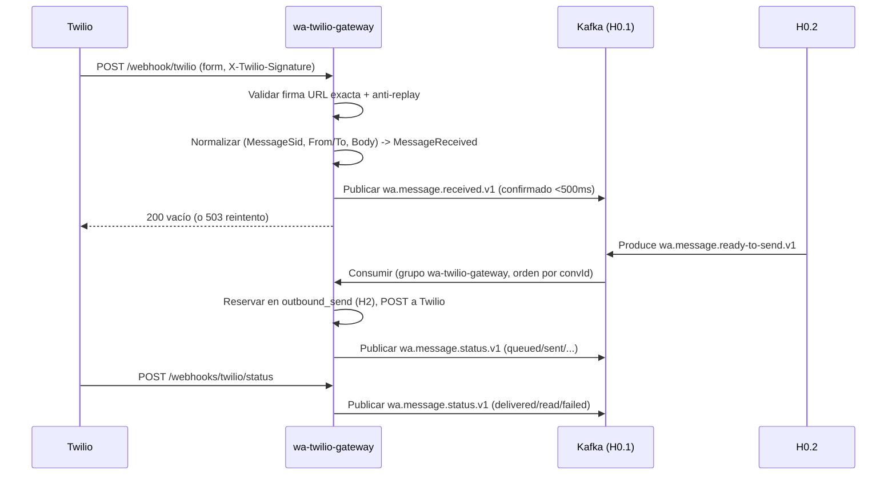

# wa-twilio-gateway (H0)

Gateway WhatsApp (Twilio) - único adaptador de Twilio. Java 21, Spring Boot 3, paquete `com.bcra.gateway`, puerto por defecto **8090**.

## Límites (roadmap)
- **Hace:** webhooks inbound/callbacks de estado con firma Twilio, anti-replay, ACK rápido, normalización a eventos del contrato, consumo de `MessageReadyToSend` y envío a Twilio, trazabilidad con `correlationId`.
- **No hace:** vínculo/identidad (H3), sesión (H2), conversación/agente (H9), coordinación de flujos (H0.2), reglas de negocio H1–H6.

## Configuración
- Spring **no** carga `.env` automáticamente. Inyectar variables desde el entorno o gestor de secretos.
- Ver [.env.example](.env.example) y [application.yml](src/main/resources/application.yml).
- Ver [TWILIO-CONFIG.md](TWILIO-CONFIG.md) para guía completa de configuración Twilio, webhook, firma, callbacks, operación y DLQ.

### Variables clave
| Variable | Uso | Default |
| --- | --- | --- |
| `SERVER_PORT` | Puerto HTTP | `8090` |
| `TWILIO_AUTH_TOKEN` | Obligatorio (firma + envío). Secreto solo por entorno | - |
| `TWILIO_WEBHOOK_PUBLIC_URL` | URL HTTPS pública exacta de `POST /webhook/twilio` | - |
| `TWILIO_STATUS_CALLBACK_PUBLIC_URL` | URL HTTPS pública exacta de `POST /webhooks/twilio/status` (obligatoria con outbound) | - |
| `TWILIO_ACCOUNT_SID`, `TWILIO_WHATSAPP_FROM` | Obligatorios con `gateway.outbound.enabled=true` | - |
| `KAFKA_BOOTSTRAP_SERVERS` | Kafka para confirmar publicaciones | `localhost:9092` |
| `WEBHOOK_ANTI_REPLAY_WINDOW_SECONDS` / `WEBHOOK_ANTI_REPLAY_CAPACITY` | Anti-replay | `300` / `10000` |
| `OUTBOUND_DB_URL`/`OUTBOUND_DB_USER`/`OUTBOUND_DB_PASSWORD` | H2 persistente para `outbound_send` | `jdbc:h2:file:./data/outbound;DB_CLOSE_ON_EXIT=FALSE;WRITE_DELAY=0` / `sa` / vacío |
| `gateway.outbound.enabled` | Habilita consumo/envío outbound | `true` |

> Fuera de local: TLS/SASL + ACL por topic. Nunca guardar credenciales en repo/logs/eventos.

## Levantar y probar
```bash
# Desde gateway/wa-twilio-gateway
./mvnw spring-boot:run        # Linux/macOS
.\mvnw.cmd spring-boot:run     # Windows
```

Verificar:
```bash
./mvnw -q -B clean verify     # Linux/macOS
.\mvnw.cmd -q -B clean verify  # Windows
```
Desde la raíz: `python scripts/verify_integracion.py` descubre este componente. JaCoCo mínimo 80%.

### Docker (local)
Stack en `docker-compose.yml` (Kafka KRaft 3.9.1, `kafka-init`, app con profile `app`). Puerto **8090**. Usa H2 en volumen para outbound (no requiere Postgres).
```powershell
# Copiar .env.example → .env y completar secretos
docker compose up -d --wait
docker compose --profile app up -d --wait
# Imagen desde raíz del repo:
# docker build -f gateway/wa-twilio-gateway/Dockerfile -t wa-twilio-gateway:local .
```
Exponer `:8090` con túnel (ngrok) y configurar URLs públicas en Twilio.

## Webhook, firma y trazabilidad
- **Endpoints:** `POST /webhook/twilio` (inbound), `POST /webhooks/twilio/status` (callbacks de estado). Actuator: `/actuator/health`, `/actuator/info`, `/actuator/prometheus` (restringir acceso).
- **Firma:** `X-Twilio-Signature` validada con `RequestValidator` del SDK oficial. Se firma la **URL pública exacta** configurada por endpoint (`TWILIO_WEBHOOK_PUBLIC_URL` / `TWILIO_STATUS_CALLBACK_PUBLIC_URL`), nunca URL reconstruida desde headers del proxy. Parámetros repetidos → 400.
- **Trazabilidad:** `correlationId` UUID propagado vía filtro HTTP (genera/canoniza, devuelve en respuesta, MDC). Correlación punta a punta: Twilio → gateway → Kafka (headers `correlationId,eventType,eventVersion`) → consumidores. Logs JSON ECS sin formularios/cuerpos/teléfonos/firma/token.
- **Respuestas:** 200 (confirmado o duplicado confirmado), 400 (inválido), 403 (firma/URL), 413/429 (tamaño/tasa), 503 (fallo/timeout/saturación/reserva) permite reintento Twilio, 500 sin detalles.
- **Límites inbound:** 16384 bytes de formulario y 120 solicitudes por IP remota por ventana de un minuto e instancia, antes de validar firma o publicar. Se cuentan también firmas inválidas. No se confía en `X-Forwarded-For`; detrás de un proxy el cupo corresponde a su IP. Se registran como máximo 10000 IP por ventana; nuevas IP reciben 429 al alcanzar esa capacidad. El callback mantiene su límite global de 120 solicitudes/minuto e instancia. Aplicar además límites de transporte en el proxy para acotar la lectura del cuerpo HTTP y coordinar cuotas entre réplicas.

Ver detalles: [WEBHOOK.md](WEBHOOK.md), [STATUS-CALLBACK.md](STATUS-CALLBACK.md).

## Contratos que produce/consume
Los schemas están en [`shared/contracts/events/`](../../shared/contracts/events/README.md) y se empaquetan en Maven. Rechazan propiedades desconocidas.

| Topic | Dirección | eventType | Payload clave | Notas |
| --- | --- | --- | --- | --- |
| `wa.message.received.v1` | **Produce** | `MessageReceived` | `customerAddress` (From), `body` | `messageId` = `MessageSid`, `conversationId` = SHA-256(`From\nTo`) |
| `wa.message.ready-to-send.v1` | **Consume** (grupo `wa-twilio-gateway`) | `MessageReadyToSend` | `customerAddress`, `body` | Concurrencia 1, ACK manual, orden por partición |
| `wa.message.status.v1` | **Produce** | `MessageStatus` | `status` (+`errorCode` opcional) | `messageId` = SID saliente o negocio según caso; relación SID→negocio en outbound |
| `wa.message.dlq.v1` | **Produce** (outbound/errores) | `DeadLetter` | coordenadas + `originalValueBase64` + códigos seguros | Ver operación/DLQ |

Ver catálogo completo y ejemplos: [`shared/contracts/events/README.md`](../../shared/contracts/events/README.md). Handoff para integración: [`shared/contracts/wa-twilio-gateway/handoff.md`](../../shared/contracts/wa-twilio-gateway/handoff.md).

## Normalización, outbound, operación
- Normalización/publicación inbound: [NORMALIZATION.md](NORMALIZATION.md)
- Callbacks de estado: [STATUS-CALLBACK.md](STATUS-CALLBACK.md)
- Envío outbound (consumo ready-to-send, persistencia H2, reintentos, reconciliación): [OUTBOUND.md](OUTBOUND.md)
- Observabilidad (métricas/logs): [OBSERVABILITY.md](OBSERVABILITY.md)
- Guía consolidada Twilio/config/operación/DLQ: [TWILIO-CONFIG.md](TWILIO-CONFIG.md)

### Diagrama (flujo principal)


Credenciales solo por entorno; Kafka fuera de local requiere TLS/SASL y ACL por topic. No se incluyen datos reales en ejemplos/tests.
