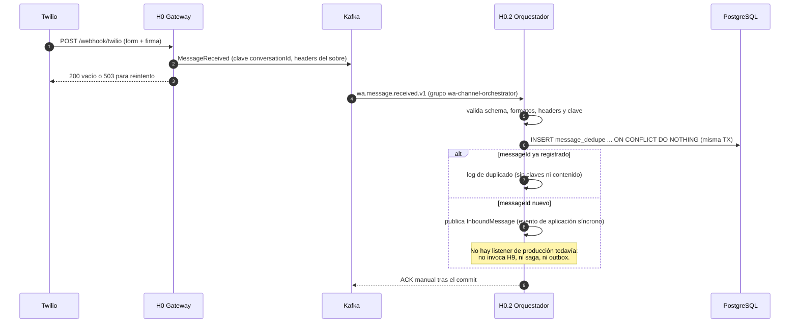
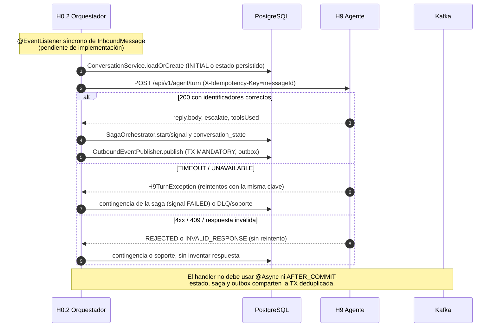
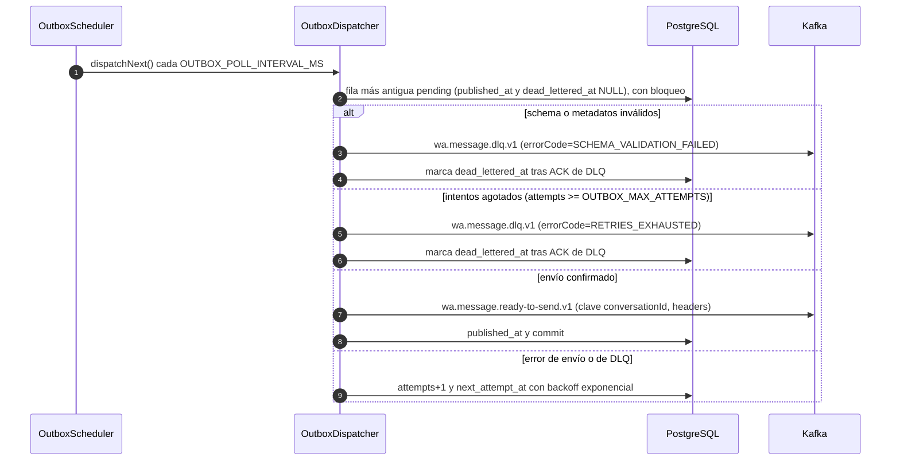
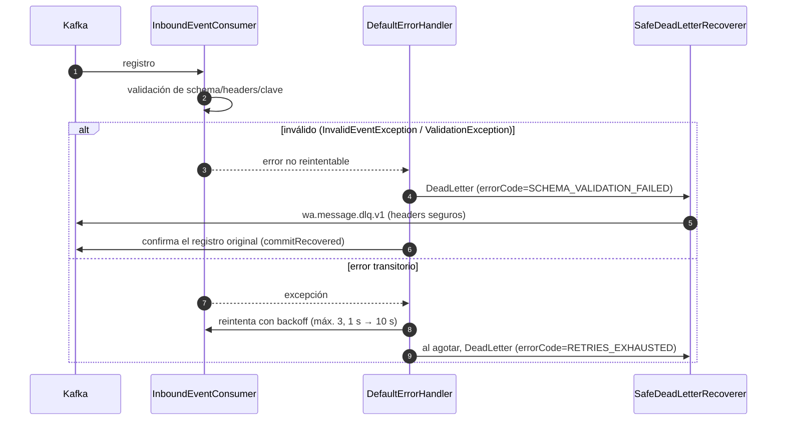

# Flujos y contingencias (H0.2)

Diagramas del ciclo del mensaje tal como está implementado en este componente. Para los
puertos que todavía no tienen handler de producción se marca explícitamente el hueco:
nada de lo que sigue supone un recorrido completo H9 extremo a extremo.

## 1. Flujo implementado hoy (inbound + deduplicación)

Puntos que no se pueden cambiar sin romper garantías:

- La clave de Kafka debe ser `conversationId`; el validador rechaza otra clave.
- El commit de `message_dedupe` y el ACK están separados: si el efecto falla, no hay ACK y la
  deduplicación se revierte; una reentrega posterior al commit se confirma sin repetir el efecto.
- La deduplicación es global por `messageId` (V6 admite hasta 256 caracteres), incluso entre conversaciones.

## 2. Flujo objetivo (handler de turno pendiente)

Este es el recorrido que falta conectar. Se dibuja para que el handler respete la transacción
ya existente; no describe código presente.

## 3. Outbox: publicación, reintentos y DLQ

El despacho es serial global: mientras una fila espera reintento, las siguientes no avanzan
(se preserva el orden por conversación). Una caída entre el ACK de Kafka y el commit reenvía
el mismo `eventId`/`messageId`: H0 debe deduplicar. `OUTBOX_ENABLED=false` detiene el scheduler
sin borrar pendientes.

## 4. Inbound: errores, reintentos y DLQ

El DLQ de inbound no conserva el valor original: `originalValueBase64` queda vacío y
`conversationId`/`messageId` del sobre derivan de `topic:partition:offset`. La recuperación
usa esas coordenadas para releer el registro original (ver [DLQ.md](DLQ.md)).

## 5. Máquinas de estado

Las sagas y sus compensaciones están en [SAGAS.md](SAGAS.md). La conversación usa
`conversation_state.state` (`INITIAL` al crear; luego el estado técnico que fije el handler)
con versión optimista y `last_message_id`.

## 6. Contingencias

| Situación | Respuesta del componente | Evidencia persistida / visible |
|---|---|---|
| Schema, headers o clave inválidos | DLQ sin reintentos | `errorCode=SCHEMA_VALIDATION_FAILED` en DLQ; métrica `orchestrator.kafka.dlq.published` |
| Error transitorio inbound | 3 reintentos con backoff; luego DLQ | `errorCode=RETRIES_EXHAUSTED`; sin ACK hasta resolver |
| `messageId` duplicado | ACK sin repetir efectos | fila existente en `message_dedupe`; log `Duplicate inbound ignored` |
| H9 timeout o 5xx | Reintenta con la misma `X-Idempotency-Key`; luego `TIMEOUT`/`UNAVAILABLE` | log con `outcome` y duración; sin cuerpos ni tokens |
| H9 4xx, 409 o 429 | `REJECTED`, sin reintento | excepción de dominio segura; no se publica outbound |
| Respuesta H9 incompleta o de otro turno | `INVALID_RESPONSE` | no se interpreta como respuesta válida |
| Falta `H9_SERVICE_TOKEN` | `NOT_CONFIGURED` antes de enviar | no sale request con datos |
| Paso de saga falla o vence | `COMPENSATING` en orden inverso, incluido el paso incierto | `saga_step_execution` con `SUPPORT_REQUIRED` si no se confirma |
| Compensación sin adaptador o rechazada | `FAILED` (no se afirma reversión) | `result_code='SUPPORT_REQUIRED'` |
| Outbox agota intentos o schema inválido | DLQ y fila terminal | `dead_lettered_at`; métricas `outbox.dlq`/`outbox.failures` |
| Falla el envío a DLQ desde outbox | Reintenta la fila con backoff; no la pierde | `attempts`/`next_attempt_at` en `outbox` |
| Reinicio del proceso | Estado, sagas, intentos y pendientes sobreviven | tablas Flyway; `WAITING` se puede continuar |
| Duplicado de salida en H0 | H0 deduplica por `messageId` | reentrega at-least-once documentada en [OUTBOUND.md](OUTBOUND.md) |

## 7. Trazabilidad

`correlationId` viaja en el header del evento inbound, en MDC mientras se procesa, en los
headers del DLQ y en las llamadas a H9. Todos los bloques que toman la correlación restauran
el valor previo del MDC al salir. Los logs son ECS y no incluyen cuerpos, teléfonos, tokens
ni mensajes de excepción remotos.
