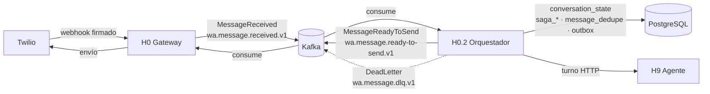

# wa-channel-orchestrator — H0.2

Orquestación técnica del canal: consume los mensajes que normaliza H0 (gateway Twilio),
deduplica por `messageId`, conserva estado técnico y sagas en PostgreSQL, invoca a H9
(agente conversacional) y publica la respuesta por outbox hacia `wa.message.ready-to-send.v1`.
Java 21, Spring Boot 3, Kafka y PostgreSQL. GroupId `com.bcra`, paquete `com.bcra.orchestrator`,
puerto **8091**.

## Qué hace / qué no hace

| Hace | No hace |
|---|---|
| Consumir inbound, deduplicar por `messageId`, serializar por `conversationId` | Payload de Twilio ni transporte Kafka (son de H0 y H0.1) |
| Estado y contexto técnico de conversación, sagas (onboarding, re-verificación) | Reglas de negocio H1–H6/H3/H2 |
| Invocar H9 con timeouts/reintentos y trazabilidad | Entender lenguaje ni implementar herramientas MCP (son de H9/H7) |
| Publicar outbound con patrón outbox e idempotencia | Lógica conversacional o de dominio |

## Arquitectura



| Paquete | Responsabilidad |
|---|---|
| `messaging.consumer` | `InboundEventConsumer`: valida schema, headers y clave; ACK manual tras commit |
| `dedup` | `DedupeService`: `INSERT ... ON CONFLICT DO NOTHING` por `messageId` global |
| `conversation` | `ConversationService`: carga/crea `conversation_state`, actualiza estado con versión optimista |
| `saga` | `SagaOrchestrator`, `SagaTimeoutScheduler`, compensaciones y ejecuciones por paso |
| `agent` | `H9TurnClient` y DTOs del turno (contrato provisional, ver [H9.md](H9.md)) |
| `outbox` | `OutboundEventPublisher` (TX obligatoria) y `OutboxDispatcher` (despacho serial) |
| `messaging.config` | Reintentos inbound, `SafeDeadLetterRecoverer` y productor idempotente |

La correlación en MDC se aplica en consumidor, conversación, cliente H9, outbox y DLQ;
las métricas Micrometer se registran en `messaging.config` y `outbox`.

Persistencia administrada por Flyway V1–V7 (`conversation_state`, `saga_instance`,
`saga_step_execution`, `message_dedupe`, `outbox`); Hibernate valida el esquema.

## Ciclo del mensaje

Secuencia completa y contingencias en [FLUJOS.md](FLUJOS.md).

1. H0 publica `MessageReceived` con clave `conversationId` y headers `correlationId/eventType/eventVersion`.
2. El consumidor valida schema, formatos, headers y clave; lo inválido va a DLQ sin reintentos.
3. `DedupeService` inserta en `message_dedupe` (UNIQUE global por `messageId`). Un duplicado se confirma sin repetir efectos.
4. Dentro de la misma transacción, un `@EventListener` **síncrono** de `InboundMessage` debe cargar la conversación, invocar H9, señalar la saga y registrar el outbox.
5. `OutboxDispatcher` publica `MessageReadyToSend` con clave `conversationId` y headers del contrato.
6. H0 consume la salida y entrega por Twilio; H0 deduplica reentregas por `messageId`.

> **Estado actual:** los mecanismos de 1–3 y 5 están implementados y probados, pero el outbox
> todavía no tiene caller de producción. Falta el handler síncrono del paso 4 (no existe listener
> de producción de `InboundMessage`). Por eso hoy el consumidor registra deduplicación sin invocar
> H9, sin señalar sagas y sin generar respuesta. No anunciar un recorrido extremo a extremo completo.

## Sagas

| Tipo | Pasos en orden | Compensación por paso |
|---|---|---|
| `ONBOARDING` | `LINK` → `ISSUE_CREDENTIAL` | deshacer vínculo provisional; revocar credencial emitida |
| `REVERIFICATION` | `VERIFY_IDENTITY` → `ISSUE_CREDENTIAL` | invalidar resultado provisional; revocar credencial emitida |

Estados persistidos: `IN_PROGRESS` → (`WAITING`) → `COMPLETED`, o `COMPENSATING` →
`COMPENSATED` / `FAILED`. `PENDING` solo existe antes de que `start` persista `IN_PROGRESS`.
`signal` exige el paso actual y un estado activo; una señal fuera de orden o posterior al cierre
se rechaza sin modificar el estado. Un fallo (`FAILED`) o el vencimiento del paso
(`orchestrator.saga.step-timeout`, default `PT24H`) dispara la compensación en orden inverso,
incluido el paso incierto. Sin adaptador `SagaCompensation` o con rechazo remoto queda `FAILED`
con `saga_step_execution.result_code = 'SUPPORT_REQUIRED'`.
Máquinas de estado y detalle en [SAGAS.md](SAGAS.md).

## Resiliencia, DLQ y trazabilidad

- **Inbound:** `DefaultErrorHandler` con backoff exponencial (3 reintentos, 1 s inicial, 10 s máximo);
  `InvalidEventException` y `ValidationException` no se reintentan. Procesamiento secuencial por partición.
- **H9:** reintenta solo `TIMEOUT`/`UNAVAILABLE` con la misma `X-Idempotency-Key=messageId`;
  `4xx` (incluido 409/429) → `REJECTED` sin repetir herramientas.
- **Outbox:** despacho serial global, `acks=all`, productor idempotente, hasta `OUTBOX_MAX_ATTEMPTS`
  envíos con backoff exponencial (tope 60 s). Agotamiento o schema inválido → DLQ y `dead_lettered_at`.
- **DLQ (`wa.message.dlq.v1`):** un solo juego de headers `correlationId/eventType/eventVersion/errorCode`;
  `originalValueBase64` vacío por privacidad. Inbound usa `conversationId` derivado del transporte;
  outbox conserva el `conversationId` real y el `messageId` saliente.
- **Trazabilidad:** `correlationId` en headers Kafka, HTTP a H9 y MDC (se restaura al salir);
  logs ECS sin cuerpos, teléfonos, tokens ni trazas HTTP/Kafka.

Recuperación y reproceso: [DLQ.md](DLQ.md). Métricas: `orchestrator.kafka.dlq.published`,
`orchestrator.outbox.published`, `orchestrator.outbox.failures`, `orchestrator.outbox.dlq`.

## Configuración

Spring **no** carga `.env` automáticamente: exportar las variables al proceso o dejar que
`docker compose` las sustituya. Copiar [.env.example](.env.example) a `.env` (fuera de git);
nunca valores reales en el repo.

| Variable | Default / función |
|---|---|
| `SERVER_PORT` | `8091` |
| `SPRING_PROFILES_ACTIVE` | Sin default; `local` fuerza PLAINTEXT |
| `SPRING_DATASOURCE_URL` | `jdbc:postgresql://localhost:5432/wa_orchestrator` |
| `SPRING_DATASOURCE_USERNAME` / `SPRING_DATASOURCE_PASSWORD` | Obligatorios, sin default |
| `ORCHESTRATOR_DB_HOST_PORT` | `5436` (solo compose: Postgres local publicado en 127.0.0.1) |
| `POSTGRES_DB` | `wa_orchestrator` (solo compose) |
| `KAFKA_BOOTSTRAP_SERVERS` | `localhost:9092`; en compose `kafka:29092` |
| `KAFKA_SECURITY_PROTOCOL` | `PLAINTEXT` solo local |
| `H9_BASE_URL` | `http://localhost:8099`; HTTPS fuera de local |
| `H9_SERVICE_TOKEN` | Vacío; sin token se rechaza la llamada antes de enviar |
| `H9_CONNECT_TIMEOUT_MS` | `1000` |
| `H9_TIMEOUT_MS` | `5000` por intento completo |
| `H9_MAX_RETRIES` | `2` (rango 0–10), hasta 3 intentos |
| `H9_BACKOFF_MS` | `200` exponencial, tope 16× |
| `ORCHESTRATOR_SAGA_STEP_TIMEOUT` | `PT24H` (ISO-8601) |
| `SAGA_TIMEOUT_CHECK_INTERVAL_MS` | `60000` |
| `OUTBOX_ENABLED` | `true`; `false` detiene el scheduler sin borrar pendientes |
| `OUTBOX_POLL_INTERVAL_MS` | `250` |
| `OUTBOX_MAX_ATTEMPTS` | `3` envíos outbound |
| `OUTBOX_BACKOFF_MS` | `1000`, exponencial con tope `60000` ms |
| `OUTBOX_SEND_TIMEOUT_MS` | `10000` |

Reintentos inbound: propiedades `orchestrator.kafka.retry.max-retries` (3),
`orchestrator.kafka.retry.initial-interval` (1000 ms) y `orchestrator.kafka.retry.max-interval`
(10000 ms), ajustables con configuración externa de Spring.

### Integración con Twilio (vía H0)

H0.2 **no** recibe webhooks de Twilio ni valida su firma: eso es del gateway. El orquestador
solo consume el evento ya normalizado. Correspondencia que fija H0:

- `messageId` = `MessageSid`; `conversationId` = SHA-256(`From\nTo`); `customerAddress` = `From`; `body` = `Body`.
- `correlationId` nace en el webhook y se propaga en headers y MDC hasta la respuesta.
- La entrega por Twilio del outbound la hace H0 al consumir `wa.message.ready-to-send.v1`.

Configuración de webhook, URL pública, firma y túnel: [TWILIO-CONFIG.md](../../gateway/wa-twilio-gateway/TWILIO-CONFIG.md).

### Integración con H9

`H9TurnClient.turn` es síncrono: `POST {H9_BASE_URL}/api/v1/agent/turn` con Bearer
`H9_SERVICE_TOKEN` y headers `X-Correlation-Id`, `X-Conversation-Id`, `X-Message-Id`,
`X-Idempotency-Key=messageId`. Request: identificadores, `customerAddress`, `body` y
`context` (contexto técnico + historial). Respuesta 200: los tres identificadores,
`reply.body`, `escalate`, `toolsUsed`; se rechaza una respuesta vacía, incompleta o de otro turno.
El contrato compartido `shared/contracts/wa-conversation-agent/turn.md` sigue pendiente de
publicación por H9; la definición provisional está en [H9.md](H9.md).

### Integración con Kafka

| Aspecto | Valor |
|---|---|
| Consumo | `wa.message.received.v1`, grupo `wa-channel-orchestrator`, concurrencia 3, `auto-offset-reset=earliest`, `max-poll-records=10` |
| ACK | `manual_immediate`, auto commit desactivado; se confirma tras el commit |
| Producción | `acks=all`, `enable.idempotence=true`, `max.in.flight.requests.per.connection=5` |
| Clave / headers | `conversationId` UTF-8; `correlationId`, `eventType`, `eventVersion` (y `errorCode` en DLQ) |
| Topics y retención | [topics.md](../../shared/contracts/events/topics.md): 3 particiones locales, received/ready-to-send 7 días, status 30, DLQ 90 |
| Entrega | at-least-once; todo consumidor debe deduplicar por `messageId` |
| Fuera de local | quitar perfil `local`, TLS/SASL, ACL: consumir `received`, producir `ready-to-send`/DLQ |

No cambiar la cantidad de particiones ni la clave sin plan de migración: una conversación
conserva partición y orden.

## Cómo levantarlo

Stack en [docker-compose.yml](docker-compose.yml) (Kafka KRaft 3.9.1 con `kafka-init` de topics
H0.1, PostgreSQL 17 `orchestrator-db`, app con profile `app`). Postgres se publica en
`127.0.0.1:5436` para no chocar con un Postgres local en 5432.

```powershell
# Desde platform/wa-channel-orchestrator
docker compose up -d --wait                    # broker + kafka-init + postgres
docker compose --profile app up -d --wait      # + wa-channel-orchestrator
# Imagen desde la raíz del repo
docker build -f platform/wa-channel-orchestrator/Dockerfile -t wa-channel-orchestrator:local .
```

Sin contenedor: JDK 21, PostgreSQL con base `wa_orchestrator` y Kafka con los topics H0.1.
Exportar las variables de `.env.example`. Desde esta carpeta:

```powershell
.\mvnw.cmd -q -B spring-boot:run     # Linux: ./mvnw
```

H9 en el host desde el contenedor: `H9_BASE_URL=http://host.docker.internal:8099`.
Si H9 solo es alcanzable por túnel, usar su URL HTTPS pública.

Health/info/prometheus: `/actuator/health`, `/actuator/info`, `/actuator/prometheus`
(restringir acceso fuera de local).

## Cómo probarlo

Desde esta carpeta (Linux: `./mvnw`):

```powershell
.\mvnw.cmd -q -B clean verify
.\mvnw.cmd -q -B verify '-Dgroups=integration'
```

JaCoCo exige ≥80% de líneas. Testcontainers (Kafka/PostgreSQL) requiere Docker y los tests
`integration` se omiten automáticamente sin él; la prueba de arranque aislada no comprueba
conectividad real. WireMock cubre H9. Para caché escribible:
`'-Dmaven.repo.local=../../.maven-cache'`.

Desde la raíz:

```powershell
python scripts/verify_integracion.py
python -m unittest discover -s scripts -p test_verify_integracion.py
```

El verificador descubre este POM en `platform/*/pom.xml` y ejecuta el wrapper con `-q -B verify`.

## Contratos

| Contrato | Uso en H0.2 |
|---|---|
| [Catálogo y sobre de eventos](../../shared/contracts/events/README.md) | `MessageReceived` (consume), `MessageReadyToSend` (produce), `DeadLetter` (produce), `MessageStatus` (consumidor pendiente) |
| [Topics](../../shared/contracts/events/topics.md) | Particiones, retención, claves y headers |
| [Handoff H0.2](../../shared/contracts/wa-channel-orchestrator/handoff.md) | Variables, contratos, operación y límites |
| `shared/contracts/wa-conversation-agent/turn.md` | Pendiente de publicación por H9; ver [H9.md](H9.md) |
| [ADR-006](../../docs/adr/ADR-006-orquestador-dedicado-ciclo-vida-canal.md), [ADR-007](../../docs/adr/ADR-007-estado-conversacion-saga-persistente.md), [ADR-008](../../docs/adr/ADR-008-limite-orquestacion-vs-conversacion-h9.md) | Decisiones de diseño |

## Guías de operación

| Área | Guía |
|---|---|
| Consumo, deduplicación y orden | [INBOUND.md](INBOUND.md) |
| Secuencias y contingencias | [FLUJOS.md](FLUJOS.md) |
| Cliente y definición provisional de turno H9 | [H9.md](H9.md) |
| Pausa, timeout y compensación | [SAGAS.md](SAGAS.md) |
| Publicación transaccional y despacho serial | [OUTBOUND.md](OUTBOUND.md) |
| Diagnóstico y reproceso | [DLQ.md](DLQ.md) |

Errores frecuentes: DLQ por `SCHEMA_VALIDATION_FAILED` (contrato/productor) o
`RETRIES_EXHAUSTED` (disponibilidad/configuración); sagas en `SUPPORT_REQUIRED` cuando falta
adaptador de compensación o fue rechazada; outbox detenido si `OUTBOX_ENABLED=false`.
Ante cualquier incidente, no copiar payloads a logs ni tickets y usar identificadores.

## Pendientes conocidos

- Handler síncrono de producción de `InboundMessage` (contexto → H9 → saga → outbox).
- Contrato compartido H9 y señales H9/H7.
- Adaptadores `SagaCompensation` para H3/H2.
- Consumidor de `wa.message.status.v1`.
