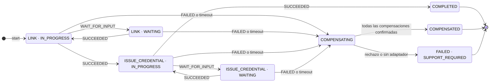
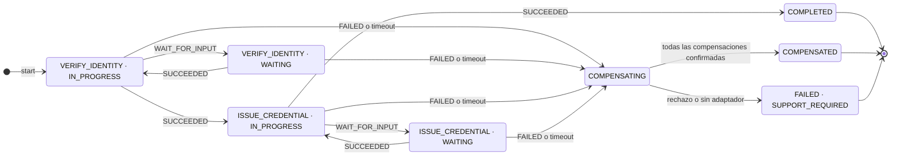

# Sagas persistentes (TASK-95)

Secuencias de punta a punta y contingencias: [FLUJOS.md](FLUJOS.md).

`SagaOrchestrator` se une a la transacción del llamador (REQUIRED). El llamador crea
la conversación con `ConversationService` y usa un UUID estable para `start`.
Las tablas de Flyway V2/V3 conservan estado, versión y ejecuciones; no requieren
recreación ni una migración adicional.

| Tipo | Pasos en orden |
|---|---|
| ONBOARDING | LINK → ISSUE_CREDENTIAL |
| REVERIFICATION | VERIFY_IDENTITY → ISSUE_CREDENTIAL |

## Máquina de estados

Los nodos combinan estado (`SagaStatus`) y paso actual (`current_step`). `WAITING` conserva
el paso y permite continuar tras un reinicio. `PENDING` existe en el esquema, pero `start`
persiste `IN_PROGRESS` dentro de la misma transacción: no es un estado observable.

### ONBOARDING

### REVERIFICATION

`start` crea la instancia y la persiste en IN_PROGRESS sobre el primer paso. `signal` exige el paso actual y un estado activo.
SUCCEEDED completa el paso y crea el siguiente, o termina en COMPLETED.
WAIT_FOR_INPUT persiste WAITING; SUCCEEDED permite continuar desde ese estado,
incluso usando una nueva instancia del proceso. FAILED o vencimiento lleva a
COMPENSATING y luego COMPENSATED si se confirman todas las compensaciones,
o FAILED con SUPPORT_REQUIRED persistido si alguna no se confirma.
Las señales fuera de orden o posteriores al cierre se rechazan sin modificar estado.

Cada paso tiene una compensación a través de `SagaCompensation`: LINK requiere
deshacer el vínculo provisional; VERIFY_IDENTITY invalidar el resultado provisional;
ISSUE_CREDENTIAL revocar la credencial emitida. El adaptador debe respetar el contrato
del propietario H3/H2, ser idempotente por sagaId + step y confirmar el resultado.
Un rechazo o error remoto se informa con `false` o `CompensationFailedException`;
ambos persisten FAILED/SUPPORT_REQUIRED sin abortar las demás compensaciones.
Se incluyen los pasos completados y el paso incierto, en orden inverso.
No se implementan llamadas ni reglas de H3/H2: aún falta el contrato H9/H7.
Sin adaptador no se afirma que un efecto remoto fue revertido: queda FAILED para
soporte. Consultar `saga_step_execution.result_code = 'SUPPORT_REQUIRED'` para
identificar estas instancias; no se publica ningún evento con formato inventado.

El consumidor de resultados H9 debe llamar a `signal` dentro de su transacción
deduplicada; no se interpreta el texto inbound para elegir un flujo o un resultado.
Un error de persistencia se propaga y revierte junto con deduplicación/outbox.
No se guarda contenido conversacional ni credenciales en el contexto de saga.

Timeout por paso: propiedad `orchestrator.saga.step-timeout` / variable
`ORCHESTRATOR_SAGA_STEP_TIMEOUT` (duración ISO-8601,
default PT24H). Scheduler: `SAGA_TIMEOUT_CHECK_INTERVAL_MS` (default 60000).
Cada vencimiento se vuelve a comprobar bajo bloqueo de escritura en una transacción
independiente, compartiendo el bloqueo con `signal`; múltiples réplicas no compensan
dos veces una saga ya cerrada. La consulta excluye estados terminales.

Verificación: `./mvnw -q -B clean verify`. `SagaOrchestratorTest` prueba ambos flujos,
pausa y continuación con un orquestador nuevo, señales inválidas, idempotencia de inicio,
compensación y scheduler. `PostgresSagaIntegrationTest` repite los casos con
PostgreSQL 16.6 mediante Testcontainers (tag integration; requiere Docker).
