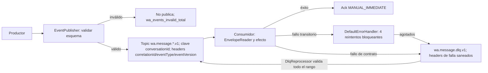
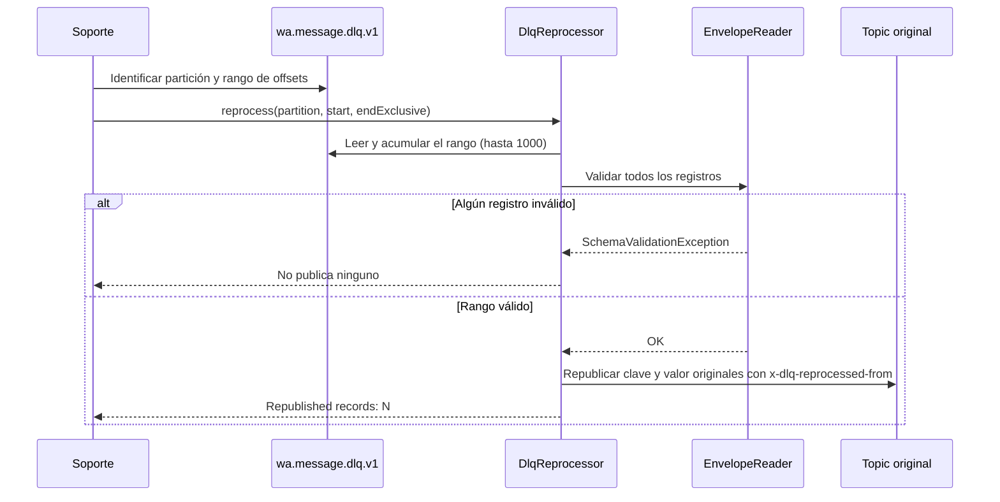

# Plataforma de eventos (`wa-event-platform`)

Columna vertebral asíncrona del canal: transporte de eventos `wa.*` sobre Kafka KRaft, topics versionados, esquemas JSON Schema validados en los dos lados, partición por `conversationId`, reintentos bloqueantes, DLQ única y observabilidad.

## Qué hace y qué no hace

**Hace:** crear y verificar los topics del piloto, publicar y consumir eventos de referencia validando el contrato, deduplicar en el consumidor de ejemplo, reintentar fallos transitorios, enviar registros a la DLQ, y exponer salud, métricas y logs con trazabilidad.

**No hace:** lógica de negocio ni de conversación, identidad o sesión, coordinación de flujos, reglas de dominio, transporte del proveedor de mensajería ni almacenamiento de dominio. Kafka es mensajería, no base de datos. El store de idempotencia del consumidor de referencia es solo de ejemplo: no sustituye la deduplicación transaccional de un consumidor de producción.

Fronteras con el gateway y el orquestador:

- [Catálogo de eventos y esquemas](../../shared/contracts/events/README.md)
- [Topics, particiones y retención](../../shared/contracts/events/topics.md)
- [Contrato operativo (handoff)](../../shared/contracts/wa-event-platform/handoff.md)
- [Runbook operativo](RUNBOOK.md)

## Requisitos y variables

Requiere Java 21. No tiene base de datos. El puerto HTTP es **8092** (`SERVER_PORT`).

| Variable | Uso | Valor por defecto |
| --- | --- | --- |
| `SERVER_PORT` | Puerto HTTP del componente | `8092` |
| `KAFKA_BOOTSTRAP_SERVERS` | Brokers de Kafka | `localhost:9092` (`kafka:19092` en el perfil `docker`) |
| `SPRING_PROFILES_ACTIVE` | Perfil activo | `local` |
| `KAFKA_HOST_PORT` | Puerto del broker publicado por Compose | `9092` |
| `APP_HOST_PORT` | Puerto de la aplicación publicado por Compose | `8092` |
| `WA_EVENT_PLATFORM_TAG` | Etiqueta de la imagen del Compose | `local` |
| `SPRING_KAFKA_SECURITY_PROTOCOL` | Protocolo de Kafka en ambientes compartidos | solo lo inyecta el ambiente |
| `SPRING_KAFKA_PROPERTIES_SASL_MECHANISM` | Mecanismo SASL en ambientes compartidos | solo lo inyecta el ambiente |
| `SPRING_KAFKA_PROPERTIES_SASL_JAAS_CONFIG` | Credenciales SASL (variable, nunca en el repo) | solo lo inyecta el ambiente |

Copiar [`.env.example`](.env.example) como `.env` y ajustar. El archivo versionado contiene solo nombres: ninguna credencial se guarda en el repositorio, en logs ni en eventos. El broker local escucha únicamente en `127.0.0.1` y usa PLAINTEXT; fuera de la PC se exigen TLS, SASL/SCRAM y ACL por topic y por grupo.

## Cómo levantarlo

Con Kafka en la PC y la aplicación con el wrapper:

```sh
docker compose up -d                 # Kafka KRaft + los cuatro topics; 127.0.0.1:9092
./mvnw spring-boot:run               # Windows: mvnw.cmd spring-boot:run
```

El perfil por defecto es `local`; también están `dev` y `test`:

```sh
SPRING_PROFILES_ACTIVE=dev ./mvnw spring-boot:run
```

En `local`, `dev` y `test` la aplicación declara los cuatro topics como `NewTopic` y registra el consumidor de referencia (`wa-event-platform-reference`, grupo propio, sin efectos de negocio). El perfil `docker` lo usa la imagen: `kafka-init` crea los topics y la aplicación solo verifica que existan al arrancar.

Stack completo en contenedores. La imagen se construye desde la raíz del repositorio porque el build copia los esquemas de `shared/contracts/events`:

```sh
docker build -f platform/wa-event-platform/Dockerfile -t wa-event-platform:local .   # desde la raíz
docker compose --profile app up -d --build --wait                                   # desde esta carpeta
docker compose --profile app down -v
```

La aplicación queda en `http://127.0.0.1:8092`.

## Cómo probarlo y verificarlo

```sh
./mvnw -q -B clean verify
```

Compila, ejecuta los tests unitarios y de integración (Testcontainers con Kafka en modo KRaft; se omiten si el daemon Docker no responde) y exige cobertura JaCoCo de al menos 80 % en líneas. El build copia los esquemas al classpath (`contracts/events`) y al arrancar se comprueba que estén los cuatro; si falta uno, la aplicación no arranca.

Desde la raíz del repositorio:

```sh
python scripts/verify_integracion.py
```

Guarda la salida detallada en `platform/wa-event-platform/target/verify.log` e imprime `OK <componente> (...)` o `FALLÓ <componente>`. En Windows no redirigir `clean verify` a un archivo dentro de `target/`: `clean` no puede borrar un log abierto.

## Contratos que produce y consume

La plataforma no publica una librería Java: cada vecino valida contra los archivos de `shared/contracts/events/`, copiados al classpath en el build.

| Evento | Topic | Productor | Consumidor |
| --- | --- | --- | --- |
| `MessageReceived` | `wa.message.received.v1` | Gateway | Orquestador; consumidor de referencia en local, dev y test |
| `MessageReadyToSend` | `wa.message.ready-to-send.v1` | Orquestador | Gateway |
| `MessageStatus` | `wa.message.status.v1` | Gateway | Orquestador / observabilidad |
| `eventType` del original | `wa.message.dlq.v1` | Consumidor que agota reintentos o rechaza un registro inválido | Soporte, para reproceso |

Detalle: [catálogo](../../shared/contracts/events/README.md), [topics](../../shared/contracts/events/topics.md) y [handoff](../../shared/contracts/wa-event-platform/handoff.md).

## Operación

- **Salud:** `GET /actuator/health`. `KafkaHealthIndicator` consulta el clúster con `AdminClient.describeCluster()` (timeout de 3 s) y marca `DOWN` con `missingTopics` si falta alguno de los cuatro topics. Fuera de `local`/`dev`/`test`, la aplicación no arranca si Kafka o los topics no están disponibles.
- **Información y métricas:** `GET /actuator/info` y `GET /actuator/prometheus`.
- **Métricas propias:** `wa_events_published_total{topic,eventType}`, `wa_events_consumed_total{topic,eventType,result}`, `wa_events_invalid_total{stage,reason}`, `wa_events_retried_total{topic}`, `wa_events_dlq_total{originalTopic,reason}`, `wa_events_publish_failed_total` y el timer `wa_event_processing_seconds{topic}`. El lag por grupo y partición lo exponen las métricas de Spring Kafka/Micrometer.
- **Alertas sugeridas:** lag creciente sostenido por grupo, cualquier incremento de `wa_events_dlq_total` y `wa_events_invalid_total` mayor que cero (siempre es un bug de contrato).
- **Logs:** JSON en formato ECS; `correlationId`, `conversationId`, `messageId` y `eventType` se ponen en el MDC y se limpian al salir. Los teléfonos se enmascaran: se conservan `+` y los 3 primeros y 2 últimos dígitos, el resto se sustituye por `*`.
- **Errores frecuentes:** ausencia de esquema en el classpath (no arranca), desajuste entre headers y sobre o `eventVersion` distinto del sufijo del topic (registro inválido a DLQ sin reintentos), broker sin topics (health `DOWN`) y fallos de red o base de datos (reintentos bloqueantes y, al agotarlos, DLQ).

El procedimiento completo está en el [runbook operativo](RUNBOOK.md): reproceso desde la DLQ, interpretación de métricas y prácticas de seguridad.

## Diagramas

Publicación, consumo y DLQ:



Reproceso desde la DLQ:


