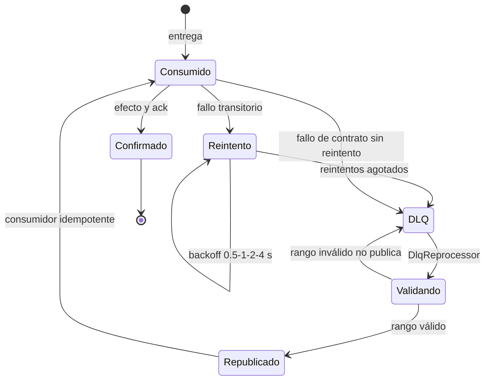

# Runbook operativo — plataforma de eventos

Aplica a `wa-event-platform` y a los cuatro topics del piloto. Es el procedimiento de operación de la plataforma; los contratos de eventos están en [`../../shared/contracts/events/README.md`](../../shared/contracts/events/README.md) y el acuerdo entre componentes en [`../../shared/contracts/wa-event-platform/handoff.md`](../../shared/contracts/wa-event-platform/handoff.md).

## Antes de empezar

- Confirmar que `/actuator/health` devuelve `UP`; si marca `DOWN` con `missingTopics`, revisar la existencia de los cuatro topics antes de cualquier reproducción.
- Tomar la causa del fallo de los logs con `correlationId` y de los headers de la DLQ (`kafka_dlt-exception-fqcn`, `kafka_dlt-exception-message`). No volcar datos personales en herramientas ni tickets.
- Corregir la causa de origen antes de reprocesar. La DLQ no es un lugar donde los mensajes viven de forma permanente.

## 1. Reintentos y DLQ

Los reintentos son **bloqueantes en el hilo de la partición** (`DefaultErrorHandler` + `ExponentialBackOffWithMaxRetries(4)`), sin topics de retry, para no romper el orden por conversación:

| Paso | Valor |
| --- | --- |
| Intervalo inicial | 500 ms |
| Multiplicador | 2.0 |
| Intervalo máximo | 8 s |
| Esperas | 0,5 s · 1 s · 2 s · 4 s (5 entregas en total, ~7,5 s) |

| Tipo de fallo | Destino |
| --- | --- |
| No reintentables: parseo JSON, fallo de esquema, desajuste headers/sobre, `eventVersion` distinto del topic, violaciones de contrato del consumidor | Directo a `wa.message.dlq.v1`, sin reintentos |
| Reintentables: red, base de datos, 5xx de un servicio | Backoff exponencial; al agotarlo, `wa.message.dlq.v1` |

`DeadLetterPublishingRecoverer` publica en `wa.message.dlq.v1` con `setFailIfSendResultIsError(true)`. La DLQ conserva la clave y los bytes originales (aunque no sean JSON válido) y agrega estos headers:

| Header | Contenido |
| --- | --- |
| `kafka_dlt-original-topic` / `-partition` / `-offset` / `-timestamp` | Origen del registro |
| `kafka_dlt-exception-fqcn` | Clase de la excepción |
| `kafka_dlt-exception-message` | Mensaje truncado a 200 caracteres y saneado |
| `x-dlq-attempts` | Entregas consumidas antes de rendirse |
| `x-dlq-failed-at` | ISO-8601 UTC |
| `correlationId`, `eventType`, `eventVersion` | Los del evento original, intactos |

No se publica `kafka_dlt-exception-stacktrace`: el detalle técnico queda en el log del consumidor con `correlationId`.



## 2. Reproceso desde `wa.message.dlq.v1`

Herramienta: `com.bcra.events.messaging.dlq.DlqReprocessor`. Arranca su propio contexto sin web y con los listeners desactivados, así que no compite con la aplicación en ejecución.

1. Identificar partición y rango: offset inicial **inclusivo** y offset final **exclusivo**. Revisar causa en logs y headers sin divulgar datos personales.
2. Si el evento es inválido por esquema, corregir el productor o descartarlo con registro de la decisión. **No** reprocesar en masa eventos inválidos.
3. Si la falla fue transitoria y ya está resuelta, preparar el classpath una vez desde esta carpeta y ejecutar:

```sh
./mvnw -q -B package dependency:copy-dependencies
java -cp "target/classes:target/dependency/*" com.bcra.events.messaging.dlq.DlqReprocessor <partition> <start> <endExclusive>
```

En Windows usar `;` en el classpath. La configuración de Kafka sale de las variables de entorno del componente (ver [`.env.example`](.env.example)). Restricciones: partición y offsets no negativos, fin mayor que inicio, como máximo 1000 posiciones por corrida y offsets dentro del rango retenido.

4. La herramienta hace dos pasadas: recoge el rango, valida **todo** el rango contra el esquema (headers de contrato y valor) y recién entonces publica. Si algún registro es inválido, **no publica ninguno**.
5. Republica cada registro en el topic que indica `kafka_dlt-original-topic` (solo uno de los tres topics de negocio), con su clave y valor originales, los headers `correlationId`/`eventType`/`eventVersion` y el header adicional `x-dlq-reprocessed-from` (`wa.message.dlq.v1:<partition>:<offset>`). **No borra** la DLQ.
6. La publicación puede interrumpirse parcialmente. Los consumidores deben deduplicar por `messageId` en la misma transacción que el efecto; inspeccionar el topic de destino antes de repetir un rango.

## 3. Observabilidad

- **Salud:** `GET /actuator/health`. `KafkaHealthIndicator` verifica el clúster con `describeCluster()` (timeout de 3 s) y la presencia de los cuatro topics. En perfiles compartidos, si Kafka o los topics faltan, la aplicación no arranca. `GET /dev/smoke` existe solo en el perfil `dev` y responde solo a loopback; no se habilita en ambientes compartidos.
- **Métricas:** `GET /actuator/prometheus` expone las métricas de Spring Kafka/Micrometer (lag por grupo y partición, throughput y errores) y estos instrumentos propios:

| Métrica | Etiquetas | Qué cuenta |
| --- | --- | --- |
| `wa_events_published_total` | `topic`, `eventType` | Publicaciones confirmadas |
| `wa_events_publish_failed_total` | — | Fallos de publicación |
| `wa_events_consumed_total` | `topic`, `eventType`, `result` | Consumos por resultado |
| `wa_events_invalid_total` | `stage`, `reason` | Eventos inválidos al producir o consumir |
| `wa_events_retried_total` | `topic` | Entregas posteriores a la primera |
| `wa_events_dlq_total` | `originalTopic`, `reason` | Registros enviados a la DLQ |
| `wa_event_processing_seconds` | `topic` | Tiempo de procesamiento (timer) |

- **Alertas sugeridas:** lag creciente sostenido por grupo, cualquier incremento de `wa_events_dlq_total` y `wa_events_invalid_total` mayor que cero (bug de contrato).
- **Trazabilidad:** `correlationId` nace en el gateway y se propaga sin cambios en headers y en el MDC. Los logs son JSON en formato ECS e incluyen `correlationId`, `conversationId`, `messageId` y `eventType`; el MDC se limpia al salir del consumidor. Para seguir un turno, buscar el `correlationId` en los logs del gateway, la plataforma y el orquestador.

## 4. Seguridad

| Riesgo | Control en este componente |
| --- | --- |
| Secretos en el repositorio | Ninguna credencial versionada. Solo nombres de variables en [`.env.example`](.env.example); los valores (incluido `SPRING_KAFKA_PROPERTIES_SASL_JAAS_CONFIG`) los inyecta el ambiente. Nunca en logs, eventos ni headers. |
| Datos personales en eventos | Payload mínimo: el teléfono viaja porque es el identificador del canal; no viajan nombre de perfil, identidad, saldos, documentos ni el cuerpo crudo del webhook. Los adjuntos viajan como referencia del proveedor. |
| Datos personales en logs | Enmascaramiento obligatorio con `PhoneMasker`: se conservan `+` y los 3 primeros y 2 últimos dígitos; el resto se sustituye por `*`. En logs y métricas se usa `conversationId`, que es opaco (por ejemplo, `+5491100000001` se registra como `+549*********01`; número ficticio). |
| Deserialización insegura | Valor como texto JSON y validación estricta contra el esquema; `FAIL_ON_UNKNOWN_PROPERTIES=true`. Prohibida la deserialización polimórfica y `trusted.packages=*`. |
| Kafka fuera de la PC | PLAINTEXT solo en local sobre `localhost`. En ambientes compartidos: TLS, SASL/SCRAM y ACL por topic y por grupo; los topics se provisionan externamente. |
| Errores hacia afuera | Sin stack traces en la DLQ ni en respuestas HTTP; el endpoint de humo solo existe en `dev` y está restringido a loopback. |

Referencias: [ADR-0002](../../docs/adr/0002-at-least-once-con-idempotencia.md), [ADR-0005](../../docs/adr/0005-reintentos-bloqueantes-y-dlq-unica.md), [ADR-0006](../../docs/adr/0006-conversation-id-opaco-y-determinista.md).
