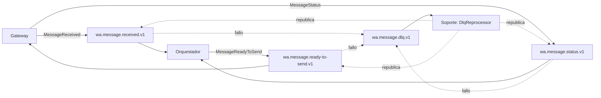

# Catálogo de eventos del canal

Fuente única de los eventos `wa.*`. Los contratos son JSON Schema draft 2020-12 en esta carpeta; no hay librería Java compartida: cada productor y consumidor valida contra estos archivos, copiados al classpath en el build. Los ejemplos de abajo usan identificadores ficticios, no datos reales.

## Topics del piloto

| Topic | `eventType` | Clave | Particiones locales | Retención | Productor | Consumidor |
| --- | --- | --- | ---: | --- | --- | --- |
| `wa.message.received.v1` | `MessageReceived` | `conversationId` | 3 | 7 días | Gateway | Orquestador; consumidor de referencia en local, dev y test |
| `wa.message.ready-to-send.v1` | `MessageReadyToSend` | `conversationId` | 3 | 7 días | Orquestador | Gateway |
| `wa.message.status.v1` | `MessageStatus` | `conversationId` | 3 | 7 días | Gateway | Orquestador / observabilidad |
| `wa.message.dlq.v1` | el del evento original | la del registro original | 1 | 30 días | Consumidor que agota reintentos o rechaza un registro inválido | Soporte técnico, para reproceso |

La replicación local es 1 y la política de limpieza es `delete`. En ambientes compartidos se usan 6 particiones, factor de replicación 3 y `min.insync.replicas=2`. No hay topics de retry: los reintentos son bloqueantes y preservan el orden por conversación. Detalle de transporte en [topics.md](topics.md).



## Esquemas

| Evento | Esquema | Topic |
| --- | --- | --- |
| Sobre común | [envelope.v1.schema.json](envelope.v1.schema.json) | (compartido) |
| `MessageReceived` | [message-received.v1.schema.json](message-received.v1.schema.json) | `wa.message.received.v1` |
| `MessageReadyToSend` | [message-ready-to-send.v1.schema.json](message-ready-to-send.v1.schema.json) | `wa.message.ready-to-send.v1` |
| `MessageStatus` | [message-status.v1.schema.json](message-status.v1.schema.json) | `wa.message.status.v1` |

El sobre contiene `eventId`, `eventType`, `eventVersion`, `occurredAt` (UTC con `Z`), `correlationId`, `conversationId`, `messageId` y `payload`, con `additionalProperties: false`. Cada esquema de evento referencia el sobre con `allOf` y solo restringe propiedades ya declaradas. Productores y consumidores validan el JSON exacto que envían y que reciben; los formatos UUID y fecha requieren validación de formato activada en el validador.

La clave Kafka es `conversationId`; los headers UTF-8 obligatorios `correlationId`, `eventType` y `eventVersion` deben coincidir con el sobre. `messageId` identifica el mensaje y es la clave de deduplicación de negocio. Los adjuntos se representan por `providerMediaId`, nunca por sus bytes. Los teléfonos son datos personales y se enmascaran en logs: se conservan `+` y los 3 primeros y 2 últimos dígitos, el resto se sustituye por `*`.

`errorCode` y `errorDetail` deben ser saneados por el productor: no incluir secretos, cuerpos de solicitudes ni trazas. Sus límites de longitud no sustituyen ese saneamiento.

## Ejemplos de cada evento

`MessageReceived` en `wa.message.received.v1`:

```json
{
  "eventId": "00000000-0000-4000-8000-000000000001",
  "eventType": "MessageReceived",
  "eventVersion": 1,
  "occurredAt": "2026-11-21T14:03:12.482Z",
  "correlationId": "00000000-0000-4000-8000-000000000002",
  "conversationId": "conv-00000000-0000-5000-8000-000000000003",
  "messageId": "SM00000000000000000000000000000001",
  "payload": {
    "channel": "whatsapp",
    "from": "+5491100000001",
    "to": "+5491100000002",
    "kind": "TEXT",
    "text": { "body": "Consulta de ejemplo" }
  }
}
```

`MessageReadyToSend` en `wa.message.ready-to-send.v1`:

```json
{
  "eventId": "00000000-0000-4000-8000-000000000004",
  "eventType": "MessageReadyToSend",
  "eventVersion": 1,
  "occurredAt": "2026-11-21T14:03:13.010Z",
  "correlationId": "00000000-0000-4000-8000-000000000002",
  "conversationId": "conv-00000000-0000-5000-8000-000000000003",
  "messageId": "00000000-0000-4000-8000-000000000005",
  "payload": {
    "to": "+5491100000001",
    "kind": "TEXT",
    "text": { "body": "Respuesta de ejemplo" },
    "replyToMessageId": "SM00000000000000000000000000000001"
  }
}
```

`MessageStatus` en `wa.message.status.v1`:

```json
{
  "eventId": "00000000-0000-4000-8000-000000000006",
  "eventType": "MessageStatus",
  "eventVersion": 1,
  "occurredAt": "2026-11-21T14:03:14.220Z",
  "correlationId": "00000000-0000-4000-8000-000000000002",
  "conversationId": "conv-00000000-0000-5000-8000-000000000003",
  "messageId": "00000000-0000-4000-8000-000000000005",
  "payload": {
    "providerMessageId": "SM00000000000000000000000000000099",
    "status": "DELIVERED"
  }
}
```

`wa.message.dlq.v1` no tiene esquema de payload: conserva la clave y los bytes del registro original (incluso si no son JSON válido) y agrega headers saneados.

| Pieza | Contenido |
| --- | --- |
| Clave y valor | Los del registro original |
| `kafka_dlt-original-topic` / `-partition` / `-offset` / `-timestamp` | Topic y posición de origen |
| `kafka_dlt-exception-fqcn` / `kafka_dlt-exception-message` | Clase y mensaje saneado y truncado; **sin** `kafka_dlt-exception-stacktrace` |
| `x-dlq-attempts` / `x-dlq-failed-at` | Entregas consumidas y fecha UTC del fallo |
| `correlationId` / `eventType` / `eventVersion` | Los del evento original, intactos |

La política de reintentos (bloqueantes, cuatro reintentos con esperas de 0,5 s, 1 s, 2 s y 4 s; errores de contrato directo a DLQ) y el procedimiento de reproceso están en el [contrato operativo](../wa-event-platform/handoff.md) y en el [runbook](../../../platform/wa-event-platform/RUNBOOK.md).

## Reglas de versionado

- **Campo opcional nuevo:** se mantiene la versión y se actualiza el esquema; los consumidores deben tolerar que el campo no venga.
- **Cambio incompatible** (campo nuevo obligatorio, campo que se va, tipo que cambia, enum que se achica): esquema y topic nuevos `wa.<entidad>.<hecho>.v<n+1>`. El productor publica en las dos versiones hasta que todos los consumidores migren; después se retira la anterior con aviso en el handoff.
- **Invariante:** `eventVersion` del sobre = sufijo `.v<n>` del topic = versión del esquema. Nunca se rompe un contrato que alguien está consumiendo.

Más contexto en las decisiones [ADR-0004](../../../docs/adr/0004-contratos-json-schema-versionados.md), [ADR-0005](../../../docs/adr/0005-reintentos-bloqueantes-y-dlq-unica.md) y [ADR-0006](../../../docs/adr/0006-conversation-id-opaco-y-determinista.md).
